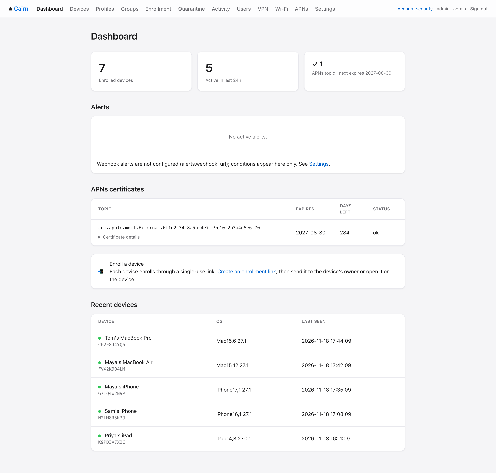

# Cairn-MDM

A single-binary, open-source Apple MDM server for homelabbers, small businesses,
non-profits, and families.

> A cairn is a small stack of stones that keeps travelers on the trail. One
> binary, one config file, one database — no container zoo required.

Cairn manages macOS and iOS/iPadOS devices: over-the-air enrollment, an embedded
(or external) SCEP certificate authority, configuration-profile delivery, and a
polished, Apple-HIG-inspired web console — all in a single Go binary that runs
natively on FreeBSD, Linux, and macOS, or in one container.

**Status: public beta (v0.2).** MIT-licensed and running its author's own
fleet. It is pre-1.0 and used at the operator's own risk: the config, API and
schema may still change (migrations are provided), and `SECURITY.md` treats v0
as experimental with best-effort fixes only.

One security gate is still open. Do not rely on a device certificate as a
network-access credential (EAP-TLS Wi-Fi) yet. Cairn decides who gets a
certificate when it issues or relays the request itself (embedded CA and
broker modes), and an external CA can be set to check a one-time challenge
with Cairn before it issues. None of this has passed an independent review or
the Wi-Fi hardware tests. See `SECURITY.md` and
[completion requirements](docs/completion-prd.md).



More of the console, with an invented fleet:
[devices](docs/screenshots/devices.png) ·
[VPN, Wi-Fi and profiles on one device](docs/screenshots/device.png) ·
[a group and its profiles](docs/screenshots/group.png) ·
[Wi-Fi networks and certificates](docs/screenshots/wifi.png) ·
[enrollment links](docs/screenshots/enrollment.png)

### What works today

- **Enrollment.** Single-use, expiring links made by an administrator with a
  fresh MFA code, for an owner looked up in LDAP/AD. Signed profiles. No Apple
  Business Manager account needed. See
  [enrollment and recovery](docs/enrollment-onboarding.md).
- **Profiles.** A library (upload a `.mobileconfig` or build Wi-Fi and Kerberos
  SSO profiles from forms), device groups, and rules that assign profiles by the
  owner's AD group or OU. See
  [directory profile targeting](docs/directory-profile-targeting.md).
- **VPN profiles.** OpenVPN profiles with a certificate per device, and native
  IKEv2 profiles: password sign-in as a download, certificate sign-in pushed by
  MDM with a key the device makes and never gives up. See
  [VPN profiles](docs/vpn-profiles.md).
- **Certificates.** An embedded CA, your own CA's key (import), an external SCEP
  CA (OpenXPKI, NDES), or Cairn as a broker in front of one. With an external
  CA, Cairn renews device identity certificates before they expire and can hand
  out one-time challenges the CA checks. See
  [certificate lifecycle](docs/certificate-lifecycle.md).
- **Sign-in.** Local accounts, LDAP/AD and OIDC, with authenticator-app MFA for
  privileged actions. See [MFA](docs/mfa.md).
- **Operations.** Verified backup bundles and restore rehearsal, webhook alerts
  with a heartbeat, an audit log, and import from NanoMDM with no re-enrollment.
  See [backup and restore](docs/backup-restore.md).

### Known limitations (beta)

- **Hardware evidence is narrow.** What has run on real devices, and what has
  only run in automated tests, is listed per requirement in
  [completion requirements](docs/completion-prd.md).
- **Renewal** of device identity certificates exists for an external CA only.
  With the embedded CA or the broker, re-enroll a device before its certificate
  expires.
- **VPN**: renewal before expiry (`[vpn] renew_before_days`) is off by default
  and has not run on a real device; macOS OpenVPN delivery is not built.
- **Auth**: Kerberos/SPNEGO is not built. OIDC has not been verified against a
  live provider.
- **Apple scope**: Declarative Device Management (DDM) and ABM/ADE automated
  enrollment are not implemented.
- **Console**: server-rendered; checked in a headless browser at desktop and
  phone widths. VoiceOver and measured contrast checks are pending.
- **Scale**: SQLite (WAL) suits homelab and small-business fleets. MySQL and
  Postgres backends are planned.

See [SECURITY.md](SECURITY.md) for the threat model and disclosure process, and
[CHANGELOG.md](CHANGELOG.md) for what changed in each release.

## Why

Most self-hostable Apple MDMs are a stack of separately-deployed services
(an MDM server, a CA, a database, a reverse proxy, an admin app) wired together
by hand. Cairn embeds the MDM protocol server ([NanoMDM][nanomdm] via
[NanoHUB][nanohub]), an optional SCEP CA, and the admin UI into one process with
one config file and a SQLite database by default. The non-ABM path is
first-class: you do not need an Apple Business Manager account to use Cairn.

## Install

```sh
# One line: detect OS/arch, download the matching release, VERIFY its sha256, install.
curl -fsSL https://raw.githubusercontent.com/nickpdawson/Cairn-MDM/main/packaging/install.sh | sh
```

A beta is a GitHub prerelease, which "latest" skips. To install one, name it:
`... | sh -s -- v0.2.0-beta.1`.

**Which setup fits you depends on whether you have LDAP/AD and where your
certificates come from. Read [the install guide](docs/install.md) first.** In
this beta, enrolling devices needs an LDAP or Active Directory server unless you
use an external SCEP CA with open enrollment.

Or grab a release tarball / `.deb` / `.rpm` from the releases page, or run the
container (`ghcr.io/nickpdawson/cairn-mdm`). Building from source: `go build ./cmd/cairn`
(pure Go, `CGO_ENABLED=0`).

## Quick start

```sh
# One command sets up config, a CA (self-signed by default), and the admin
# account. Enrollment links then need an LDAP/AD directory in the config
# (docs/install.md). Note: running your own CA is a real
# security decision (offline root, rollover — see SECURITY.md); if you already
# have a PKI, prefer external mode so the signing key never lives on this host.
cairn init --public-url https://mdm.example.org

# Then load an APNs push certificate (free via mdmcert.download) and serve:
cairn pushcert request -email you@example.org      # → decrypt → identity.apple.com → import
cairn serve
```

Prefer the browser? Write a `cairn.toml` (see `packaging/cairn.example.toml`),
run `cairn serve`, and open `https://<public_url>/setup`. While no administrator
exists Cairn writes a one-time token to `<storage.path>.setup-token` (0600) on
the host; entering it creates the first administrator, signs you in and hands you
the authenticator approval code. The page lists what is still missing (push
certificate, directory) and disappears once setup completes. The APNs request,
decrypt and install steps are also available under the console's APNs page.

mdmcert.download is one of three ways to get the push certificate request
signed. An organization with an Apple Developer membership can also apply to
sign its own; see [obtaining an MDM certificate](docs/obtain_mdm_cert_guide.md).

`packaging/cairn.example.toml` documents the full config surface. Health
endpoints: `GET /healthz` (liveness), `GET /readyz` (readiness), `GET /version`.

## Migrating from NanoMDM

`cairn import -from-mysql <dsn>` migrates an existing NanoMDM (MySQL) deployment
with **zero device re-enrollment** — it replays the stored check-in state through
Cairn's storage and verifies every enrollment is pushable and every certificate
association intact before declaring success. See
[docs/migrating-from-nanomdm.md](docs/migrating-from-nanomdm.md).

## Roadmap

Before 1.0:

- Independent review of enrollment authorization and certificate renewal.
- EAP-TLS Wi-Fi proven on real Macs and iPhones, with renewal and revocation.
- Renewal for the embedded CA and broker modes.
- VPN certificate renewal proven on real devices.
- A qualified release: fixed candidate, hardware matrix, recorded soak.

Later: Declarative Device Management, ABM/ADE automated enrollment,
account-driven enrollment and Platform SSO.

## License

[MIT](LICENSE). Cairn builds on the MicroMDM ecosystem
([NanoMDM][nanomdm], [NanoHUB][nanohub], and related projects); see `NOTICE` for
upstream attributions.

[nanomdm]: https://github.com/micromdm/nanomdm
[nanohub]: https://github.com/micromdm/nanohub

Current completion work and remaining acceptance gates are tracked in
[completion requirements](docs/completion-prd.md). For the new admin workflow
and explicit same-topic CLI renewal, see [APNs lifecycle](docs/apns-lifecycle.md).
